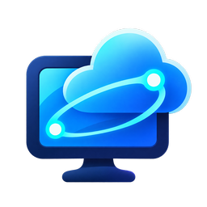

<p align="center">
  
</p>

# Deskfeed

Your work desktops on the COSMIC™ desktop. A native COSMIC app that **works with Azure Virtual Desktop and Windows 365**: sign in with your work or school account, see the desktops your organization assigned to you, and connect to them.

> **Unofficial community project.** Not affiliated with or endorsed by Microsoft or System76. For compatibility it signs in with Microsoft's public Remote Desktop client identity, the same one FreeRDP uses. It is not a Microsoft product.

**Status: early development (0.1).** It works day to day on the author's setup (Arch Linux, COSMIC, one Azure Virtual Desktop tenant). Other tenants and distributions are untested. Expect rough edges and read [Known limitations](#known-limitations).

## Features

- **Several accounts side by side**, each in the sidebar, each with its own sign-in.
- **Stays signed in** between starts: the sign-in is kept in your desktop keyring (Secret Service), never in files. Your organization's sign-in rules still apply.
- **All your desktops** from every workspace your accounts can use.
- **Connect with Entra sign-in** (no Windows password) by default; host pools that need a Windows password get a native dialog that allows pasting.
- **Settings per account, with per-desktop overrides:** full screen or window, all monitors, open on a new COSMIC workspace, sound, microphone, clipboard, and how long to wait for the desktop.
- **Built for COSMIC:** libcosmic UI that follows the COSMIC design, the remote desktop groups under the app in the dock, light and dark themes.
- **Checks its dependencies** at startup and tells you what to install.

## Requirements

Native packages only; there is no Flatpak ([ADR 0010](./docs/adr/0010-native-only-and-dependency-check.md)). The app checks these at startup and under **View → Dependencies**.

| Dependency | Minimum | Needed for | Arch Linux package |
|---|---|---|---|
| COSMIC desktop (cosmic-comp with window management v4) | Epoch 1 | The app itself; "Open on a new workspace" | `cosmic-session` |
| FreeRDP with the SDL client (`sdl-freerdp3`), built with `WITH_AAD=ON` | 3.32.2 | Connecting to desktops, Entra sign-in to desktops | `freerdp` |
| WebKitGTK 6 and GTK 4 | 2.52 | The Microsoft sign-in window | `webkitgtk-6.0` |
| A Secret Service (oo7, GNOME Keyring, …) | — | Staying signed in (optional) | `oo7` or `gnome-keyring` |

To build: Rust with edition 2024 (developed and tested with Rust 1.99) and [`just`](https://github.com/casey/just). Building the sign-in helper needs the GTK 4 and WebKitGTK 6 development files (on Arch Linux they come with the packages above).

See [Dependencies](#dependencies) for every library the app is built from.

## Installation

```sh
git clone https://github.com/rabol/cosmic-ext-deskfeed.git
cd cosmic-ext-deskfeed
just build-release     # as your user
sudo just install      # copies the built files to /usr
```

This installs the app (`/usr/bin/cosmic-ext-deskfeed`), its sign-in helper (`/usr/libexec/cosmic-ext-deskfeed/`), the desktop entry, the icons and the AppStream metadata. Start **Deskfeed** from the COSMIC launcher.

`sudo just uninstall` removes them again. Your accounts and settings stay in your home folder.

## Using it

1. **Sign in.** Start the app and select **Sign in**. Microsoft's sign-in page opens in a small window; sign in as you normally do (password, Authenticator, your company's sign-in page).
2. **Connect.** Your workspaces and desktops appear. Select **Connect**. Microsoft may show *"Are you trying to sign in to Azure Virtual Desktop Client?"* or ask for your password again, depending on your organization's rules; then the desktop opens.
3. **More accounts:** **Add account** in the sidebar (or **Account → Add account**).
4. **Settings:** the gear in the header bar sets defaults for the selected account; the gear on a desktop row overrides them for that desktop.
5. **Sign out:** **Account → Sign out**, or **Sign out** in the account settings. This removes the account's saved sign-in and cookies from this computer.

If something doesn't work, **View → Dependencies** shows what's missing, and **View → Open log folder** opens the log.

## Known limitations

- **One Microsoft confirmation page per connection.** FreeRDP fetches the token for the remote Windows machine itself, through a sign-in page; it offers no way for the app to supply that token ([details](./docs/milestone-1.md)). The official Windows and macOS clients don't show this page.
- **Your organization's sign-in frequency applies.** If it requires a fresh sign-in after a set time (for example *"Every time"*, which allows reuse for five minutes), the app asks you to sign in again; it doesn't work around such policies.
- **Window size under auto-tiling.** FreeRDP sends a window's size to Windows only after a window change, so the app briefly maximizes and restores the desktop's window once it has connected; you may see it flicker once.
- **RemoteApps** are listed but can't be started yet.
- **Proxies:** the app and FreeRDP use the proxy from the usual environment variables (`https_proxy`, `http_proxy`, `all_proxy`, `no_proxy`). FreeRDP supports only `http://` and `socks5://` proxies; desktop-environment proxy settings that aren't exported as variables are not used.
- **Azure public cloud only**; no sovereign clouds.
- **No Flatpak**, by design.

## Privacy and security

- Refresh tokens are stored only in your desktop keyring; access tokens stay in memory. Windows passwords are never stored.
- Passwords and tokens reach FreeRDP through a private pipe, never through the command line or environment.
- Your account's tokens are only sent to the Microsoft addresses the app was built for (`login.microsoftonline.com`, `*.wvd.microsoft.com`), always over HTTPS.
- The Microsoft sign-in window is a separate, locked-down program: HTTPS only, no pop-ups or downloads, and it only hands back the sign-in result.
- The log (`~/.local/state/cosmic-ext-deskfeed/app.log`, readable only by you, at most about 2 MiB) contains no passwords or tokens.
- No telemetry.

Design details: [specs.md](./specs.md) and the [architecture decision records](./docs/adr/README.md).

## Development

```sh
just build-debug      # build app and sign-in helper
just test             # run the tests
just check            # clippy, pedantic
just run              # run a release build
```

| Path | Contents |
|---|---|
| `src/app/` | The COSMIC user interface and app logic (`decide.rs` holds the tested logon decisions) |
| `src/auth/` | Sign-in attempts, tokens, ID token checks |
| `src/service/` | HTTP client, allowed endpoints, feed discovery and parsing |
| `src/sessions/` | Connection-file filtering, starting and supervising FreeRDP |
| `src/accounts.rs`, `src/secrets.rs` | Per-account storage; the Secret Service (keyring) |
| `src/settings.rs`, `src/workspace.rs` | Connection settings; "open on a new workspace" |
| `src/deps.rs`, `src/log.rs` | Dependency check; the log file |
| `signin/` | `cosmic-ext-deskfeed-signin`, the sign-in window ([why a separate program](./docs/adr/0007-sign-in-web-view.md)) |
| `docs/` | Progress notes and architecture decision records |

Dependencies are kept to a minimum on purpose ([ADR 0003](./docs/adr/0003-minimal-dependencies.md)); each new one needs a reason in an ADR.

### Translations

[Fluent](https://projectfluent.org/) is used for localization. Translations live in [`i18n/`](./i18n): copy the [English files](./i18n/en), rename the folder to the [ISO 639-1 code](https://en.wikipedia.org/wiki/List_of_ISO_639-1_codes) of your language, and translate the [messages](https://projectfluent.org/fluent/guide/hello.html).

### Packaging

Vendor the dependencies and build offline; use `rootdir` and `prefix` to choose where files go:

```sh
just vendor
just build-vendored
just rootdir=debian/cosmic-ext-deskfeed prefix=/usr install
```

## Dependencies

Kept to a minimum on purpose; each one has a reason ([ADR 0003](./docs/adr/0003-minimal-dependencies.md)).

**Runtime (system):** see [Requirements](#requirements): COSMIC, FreeRDP 3.32.2+ with `WITH_AAD=ON`, WebKitGTK 6 with GTK 4, and optionally a Secret Service.

**Build tools:** Rust (edition 2024) with Cargo, and `just`.

**Rust crates used directly by the app** (`cosmic-ext-deskfeed`):

| Crate | Used for |
|---|---|
| `libcosmic` (pinned revision, [ADR 0002](./docs/adr/0002-pin-libcosmic-revision.md)) | The COSMIC user interface, config, and COSMIC's Wayland protocols (window and workspace management) |
| `tokio` | Running network and keyring work off the UI thread |
| `ureq` + `rustls` (ring) | HTTPS to Microsoft, with the system's trusted certificates ([ADR 0008](./docs/adr/0008-http-and-crypto-crates.md)) |
| `ring` | Checking the signature of Microsoft's ID tokens |
| `sha2`, `base64`, `getrandom` | PKCE and state for sign-in; opaque IDs for accounts and desktops |
| `zbus` | The Secret Service (keyring) over D-Bus ([ADR 0009](./docs/adr/0009-secret-service-over-zbus.md)) |
| `serde`, `serde_json` | Microsoft's JSON responses, settings, the helper protocols |
| `roxmltree` | Reading the desktop lists (XML) |
| `url` | Parsing and checking addresses |
| `dirs`, `libc` | Standard folders; process groups and pipes for FreeRDP |
| `i18n-embed`, `i18n-embed-fl`, `rust-embed` | Translations |
| `open` | Opening links and the log folder |
| `xdgen` (build only) | Generating the desktop entry and AppStream metadata |

**Rust crates used by the sign-in window** (`cosmic-ext-deskfeed-signin`, [ADR 0007](./docs/adr/0007-sign-in-web-view.md)): `gtk4` and `webkit6` (the web view), `serde`, `serde_json`, `url`. Only this helper links GTK and WebKit.

Most of the crates in `Cargo.lock` (696 in total) come in through libcosmic. The crates this project adds beyond libcosmic's own dependency tree are `ureq`, `rustls` and `ring` (with rustls's certificate-verifier crates) for HTTPS, `open` (from the COSMIC app template), and `gtk4` and `webkit6` in the sign-in helper. All other crates in the table were already part of libcosmic's tree (checked with `cargo tree`).

## Contributing and security

See [CONTRIBUTING.md](./CONTRIBUTING.md). Please report security problems privately as described in [SECURITY.md](./SECURITY.md). Changes are listed in [CHANGELOG.md](./CHANGELOG.md); third-party licenses in [THIRD-PARTY-LICENSES.md](./THIRD-PARTY-LICENSES.md).

## Contact

**cosmic-ext-avd@rabol.dev**. For bugs and ideas, please prefer [GitHub issues](https://github.com/rabol/cosmic-ext-deskfeed/issues); never include your organization's tenant details.

## License

[MIT](./LICENSE) © 2026 Steen Rabol.

COSMIC is a trademark of System76, Inc. Microsoft, Azure, Azure Virtual Desktop and Windows 365 are trademarks of the Microsoft group of companies. They are used here only to name the services this app works with.
